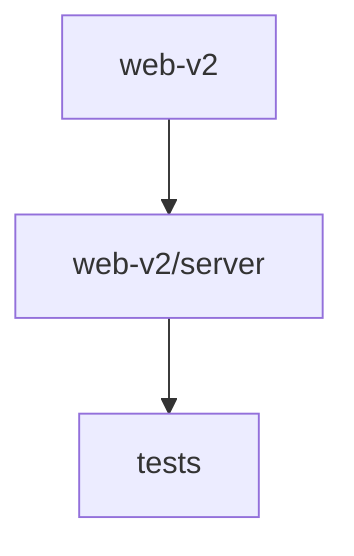

# 📚 fajer-parsa Documentation

Welcome to the complete documentation for this repository. This documentation is automatically generated and maintained by Woden Docbot.

  

## 🔗 Quick Links

[📂 tests](./tests/README.md) | [📂 web-v2](./web-v2/README.md)
[📋 Dependencies](./DEPENDENCIES.md)

---

> A Vite-based React frontend (TypeScript/JSX) with a colocated server intake subdirectory and Vitest test specs for verifying behavior.

## 📖 Overview

fajer-parsa is a web application repository centered on a versioned frontend (web-v2) and a small set of tests. The web-v2 directory contains the frontend assets, project-level build and config files, and a server/ subdirectory focused on intake handling and its tests.

The repo includes a top-level tests directory of Vitest specifications intended to exercise and verify behaviors. The stack visible in the tree and manifests includes React, TypeScript/JavaScript, Vite, Tailwind-related tooling, Node.js and Vitest.

### 🧩 Key Components

| Component | Purpose | Technologies |
| --- | --- | --- |
| **web-v2** | Holds the web application's version‑2 frontend, root configuration/build files, and a server subdirectory for intake handling. | `React`, `TypeScript`, `Vite` |
| **web-v2/server** | Server-side intake handling implementation and its associated tests, colocated to exercise intake logic and behavior. | `Node.js`, `TypeScript`, `JavaScript` |
| **tests** | Contains Vitest test specifications (fajer-parsa.test.js) used to verify behavior and regressions in the codebase. | `Vitest`, `JavaScript`, `Node.js` |

**Component Architecture:**

### 🏗️ Architecture

Flat repository with a web-v2 frontend (config, entry points, assets) and a web-v2/server subdirectory for intake logic; a root tests folder holds Vitest specs to validate behavior.

### 💡 Use Cases

- ✦ Build and run the frontend (Vite + React)
- ✦ Exercise and verify intake logic implemented in web-v2/server
- ✦ Run Vitest test specifications to validate behavior and regressions

### 🔧 Technologies

**Languages:**  

**Frameworks:** 

**Databases:** 
        

### 📦 External Dependencies

The following external packages are used across the project:

- `@fontsource-variable/manrope`
- `@fontsource-variable/vazirmatn`
- `@radix-ui/react-dialog`
- `@tailwindcss/vite`
- `@types/react`
- `@types/react-dom`
- `@vitejs/plugin-react`
- `clsx`
- `dotenv`
- `lucide-react`
- `motion`
- `next-themes`
- `playwright`
- `react`
- `react-dom`
- `tailwind-merge`
- `tailwindcss`
- `testdriverai`
- `typescript`
- `vite`
- `vitest`

---

## 📑 Documentation Sections

### [tests](./tests/README.md)
Holds test specifications for the project; contains Vitest test files used to verify behavior and regressions in related code.

This directory contains test specification files for the project.

### [web-v2](./web-v2/README.md)
Holds the web application's version 2 frontend assets, configuration, and a server subdirectory focused on intake handling and its tests.

This directory contains the web-v2 application surface: root-level configuration and build files plus a dedicated server subdirectory for intake handling.

### Files at the repository root

- [vitest.config.js](./vitest.config.js.md)

---

## 📊 Documentation Statistics

- **Files Documented**: 3
- **Directories**: 5
- **Coverage**: 5%
- **Eligible Source Files**: 60
- **Last Updated**: 2026-10-30

---

## 🧭 How to Navigate

> ℹ️ **INFO**
> Each directory has its own README.md with detailed information about that section. Use the breadcrumb navigation at the top of each page to navigate back to parent directories.

### Navigation Features

- **Breadcrumbs** - At the top of each page, showing your current location
- **Directory READMEs** - Each folder has a comprehensive overview
- **File Documentation** - Click through to individual file documentation
- **Search** - Use GitHub's search or your IDE's search functionality

---

## 🤖 About Woden DocBot

This documentation is automatically generated and kept up-to-date by Woden DocBot, an AI-powered documentation assistant. DocBot analyzes code on every pull request and updates documentation to reflect changes.

### Features

- **Automatic Updates** - Documentation updates on every PR
- **Comprehensive Coverage** - Files, functions, classes, and directories
- **Smart Navigation** - Breadcrumbs, related files, and parent links
- **AI-Powered** - Uses Azure GPT models for intelligent documentation generation

---

*Generated by Woden DocBot for fajer-parsa*