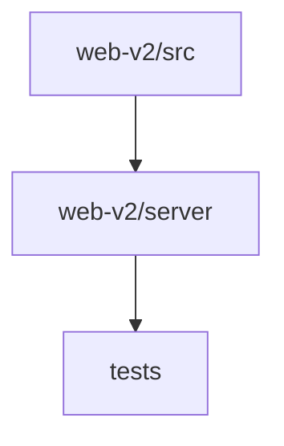

# 📚 fajer-parsa Documentation

Welcome to the complete documentation for this repository. This documentation is automatically generated and maintained by Woden Docbot.

  

## 🔗 Quick Links

[📂 tests](./tests/README.md) | [📂 web-v2](./web-v2/README.md)
[📋 Dependencies](./DEPENDENCIES.md)

---

> A repository that contains a Vite-based React frontend and accompanying server code for the web-v2 application, plus a small Vitest test suite.

## 📖 Overview

This repository groups a web-v2 application and a focused test spec. The web-v2 directory contains the application's source UI (src/) and server-side request handling (server/), plus root configuration and preview HTML files used to build and run the deliverable. The src area holds React/TypeScript components, global entry points and styles; the server directory organizes office and intake request logic and related tests.

A separate tests/ directory contains a Vitest specification (fajer-parsa.test.js) intended to verify behaviors and regressions. The project is configured with TypeScript and Vite and includes typical frontend tooling and config files (package.json, tsconfig.json, vite.config.ts).

### 🧩 Key Components

| Component | Purpose | Technologies |
| --- | --- | --- |
| **web-v2/src** | Client-side application code: React and TypeScript components, entry points, global styles and static preview HTML used by the web-v2 frontend. | `React`, `TypeScript`, `CSS` |
| **web-v2/server** | Server-side request handling and related modules that implement office and intake logic and server tests. | `Node.js`, `TypeScript`, `JavaScript` |
| **tests** | Holds Vitest specifications for the project; includes a single test file (fajer-parsa.test.js) used to run assertions against the codebase. | `JavaScript`, `Vitest` |

**Component Architecture:**

### 🏗️ Architecture

Top-level web-v2 directory contains frontend (src/) and server/ subdirectories plus root config and preview HTML files; a separate tests/ folder holds Vitest specs. The layout separates client UI, server logic, and test specifications.

### 💡 Use Cases

- ✦ Build and run the web-v2 frontend application
- ✦ Run server-side request handlers and related server tests
- ✦ Execute Vitest test specifications for regression checks

### 🔧 Technologies

**Languages:**  

**Frameworks:** 

**Databases:** 
     

### 📦 External Dependencies

The following external packages are used across the project:

- `@fontsource-variable/manrope`
- `@fontsource-variable/vazirmatn`
- `@radix-ui/react-dialog`
- `@tailwindcss/vite`
- `@types/react`
- `@types/react-dom`
- `@vitejs/plugin-react`
- `clsx`
- `dotenv`
- `lucide-react`
- `motion`
- `next-themes`
- `playwright`
- `react`
- `react-dom`
- `tailwind-merge`
- `tailwindcss`
- `testdriverai`
- `typescript`
- `vite`
- `vitest`

---

## 📑 Documentation Sections

### [tests](./tests/README.md)
Holds test specifications for the project; contains Vitest test files used to verify behavior and regressions in related code.

This directory contains test specification files for the project.

### [web-v2](./web-v2/README.md)
Contains the web-v2 application's frontend and server code: source-side UI code, server request handlers, and supporting project configuration and build files.

The web-v2 directory groups the code and assets required to build and run the web-v2 application.

### Files at the repository root

- [vitest.config.js](./vitest.config.js.md)

---

## 📊 Documentation Statistics

- **Files Documented**: 11
- **Directories**: 7
- **Coverage**: 15%
- **Eligible Source Files**: 74
- **Last Updated**: 2026-10-30

---

## 🧭 How to Navigate

> ℹ️ **INFO**
> Each directory has its own README.md with detailed information about that section. Use the breadcrumb navigation at the top of each page to navigate back to parent directories.

### Navigation Features

- **Breadcrumbs** - At the top of each page, showing your current location
- **Directory READMEs** - Each folder has a comprehensive overview
- **File Documentation** - Click through to individual file documentation
- **Search** - Use GitHub's search or your IDE's search functionality

---

## 🤖 About Woden DocBot

This documentation is automatically generated and kept up-to-date by Woden DocBot, an AI-powered documentation assistant. DocBot analyzes code on every pull request and updates documentation to reflect changes.

### Features

- **Automatic Updates** - Documentation updates on every PR
- **Comprehensive Coverage** - Files, functions, classes, and directories
- **Smart Navigation** - Breadcrumbs, related files, and parent links
- **AI-Powered** - Uses Azure GPT models for intelligent documentation generation

---

*Generated by Woden DocBot for fajer-parsa*