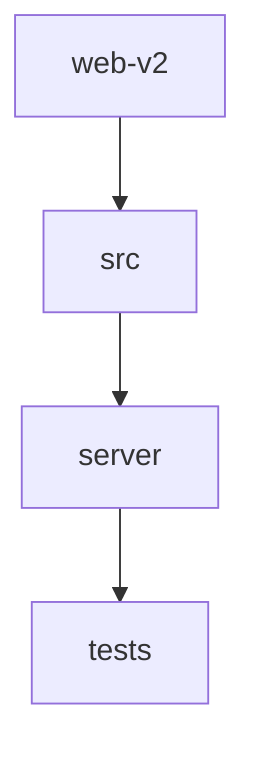

# 📚 fajer-parsa Documentation

Welcome to the complete documentation for this repository. This documentation is automatically generated and maintained by Woden Docbot.

  

## 🔗 Quick Links

[📂 tests](./tests/README.md) | [📂 web-v2](./web-v2/README.md)
[📋 Dependencies](./DEPENDENCIES.md)

---

> A web application repository organized around a web-v2 project with a TypeScript/React frontend, a Node.js server subtree, and a small Vitest test suite.

## 📖 Overview

fajer-parsa is organized around a top-level web-v2 application that groups frontend and server code alongside project configuration. The web-v2 directory contains project and build configuration (package.json, tsconfig.json, vite.config.ts, vercel.json, etc.), a src/ frontend implemented with React and TypeScript, and a server/ subtree with server-side request handling and adapters. A separate tests/ directory holds a Vitest test specification (fajer-parsa.test.js). The repository is built with Vite, TypeScript, React and standard web assets (HTML, CSS, JSX), and uses Node.js/npm for tooling and dependencies.

### 🧩 Key Components

| Component | Purpose | Technologies |
| --- | --- | --- |
| **web-v2** | Top-level project directory that contains build/config files and groups the frontend (src/) and backend (server/) code for the application. | `Vite`, `TypeScript`, `npm` |
| **src** | Frontend source for the web-v2 application: root-level app entry files, global styles, and feature subdirectories implementing the UI. | `React`, `TypeScript`, `JSX` |
| **server** | Server-side implementations including request handling, adapters, entrypoints, and server tests organized by feature. | `Node.js`, `TypeScript`, `JavaScript` |
| **tests** | Contains Vitest test specifications (a flat layout with fajer-parsa.test.js) used to verify behavior and regressions. | `Vitest`, `JavaScript`, `Node.js` |

**Component Architecture:**

### 🏗️ Architecture

A monorepo-style layout where web-v2 is the application root: configuration and build files sit alongside src/ (frontend) and server/ (backend); tests/ holds Vitest specs at the repository level.

### 💡 Use Cases

- ✦ Build and run the web-v2 frontend and server application using Vite/Node.js
- ✦ Execute Vitest-based tests located in the tests/ directory

### 🔧 Technologies

**Languages:**  

**Frameworks:** 

**Databases:** 
     

### 📦 External Dependencies

The following external packages are used across the project:

- `@fontsource-variable/manrope`
- `@fontsource-variable/vazirmatn`
- `@radix-ui/react-dialog`
- `@tailwindcss/vite`
- `@types/react`
- `@types/react-dom`
- `@vitejs/plugin-react`
- `clsx`
- `dotenv`
- `lucide-react`
- `motion`
- `next-themes`
- `playwright`
- `react`
- `react-dom`
- `tailwind-merge`
- `tailwindcss`
- `testdriverai`
- `typescript`
- `vite`
- `vitest`

---

## 📑 Documentation Sections

### [tests](./tests/README.md)
Holds test specifications for the project; contains Vitest test files used to verify behavior and regressions in related code.

This directory contains test specification files for the project.

### [web-v2](./web-v2/README.md)
Top-level web-v2 project directory that groups frontend source (src/), server implementations (server/), and project-level configuration and deployment files to support building and running the web-v2 application.

The web-v2 directory is the repository root for the web-v2 application.

### Files at the repository root

- [vitest.config.js](./vitest.config.js.md)

---

## 📊 Documentation Statistics

- **Files Documented**: 14
- **Directories**: 9
- **Coverage**: 19%
- **Eligible Source Files**: 72
- **Last Updated**: 2026-10-31

---

## 🧭 How to Navigate

> ℹ️ **INFO**
> Each directory has its own README.md with detailed information about that section. Use the breadcrumb navigation at the top of each page to navigate back to parent directories.

### Navigation Features

- **Breadcrumbs** - At the top of each page, showing your current location
- **Directory READMEs** - Each folder has a comprehensive overview
- **File Documentation** - Click through to individual file documentation
- **Search** - Use GitHub's search or your IDE's search functionality

---

## 🤖 About Woden DocBot

This documentation is automatically generated and kept up-to-date by Woden DocBot, an AI-powered documentation assistant. DocBot analyzes code on every pull request and updates documentation to reflect changes.

### Features

- **Automatic Updates** - Documentation updates on every PR
- **Comprehensive Coverage** - Files, functions, classes, and directories
- **Smart Navigation** - Breadcrumbs, related files, and parent links
- **AI-Powered** - Uses Azure GPT models for intelligent documentation generation

---

*Generated by Woden DocBot for fajer-parsa*