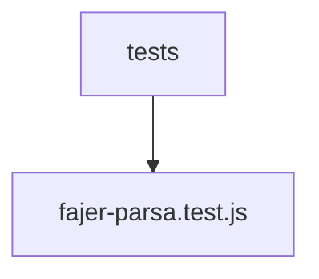

# 📚 fajer-parsa Documentation

Welcome to the complete documentation for this repository. This documentation is automatically generated and maintained by Woden Docbot.

  

## 🔗 Quick Links

[📂 tests](./tests/README.md)
[📋 Dependencies](./DEPENDENCIES.md)

---

> A React + Vite codebase (JS/TS/JSX) with Tailwind and font packages, accompanied by Vitest-based automated tests.

## 📖 Overview

This repository includes a test suite and the package manifests that declare the project's frontend dependencies. The tests folder holds a flat set of Vitest test modules, with a root-level fajer-parsa.test.js that exercises the codebase.

The codebase is built with React and Vite and uses JavaScript/JSX and TypeScript sources, along with Tailwind CSS and font packages. Dependencies and build tooling are declared in the project manifests, and Vitest is configured as the test runner for the tests present in the tests directory.

### 🧩 Key Components

| Component | Purpose | Technologies |
| --- | --- | --- |
| **tests** | Holds the project's Vitest test modules; a flat collection of test files intended to be discovered and run by the Vitest test runner. | `Vitest`, `JavaScript` |
| **fajer-parsa.test.js** | Root-level test file that defines test suites and cases to validate behavior of the implementation code referenced by the tests. | `JavaScript`, `Vitest` |

**Component Architecture:**

### 🏗️ Architecture

Repository structure centers on a flat tests directory with a root test file; the project itself is a Vite-powered React codebase (JS/TS/JSX) with Tailwind and font packages declared in its manifests.

### 💡 Use Cases

- ✦ Automated unit and integration testing of the repository code using Vitest

### 🔧 Technologies

**Languages:**  

**Frameworks:** 

**Databases:** 
       

### 📦 External Dependencies

The following external packages are used across the project:

- `@fontsource-variable/manrope`
- `@fontsource-variable/vazirmatn`
- `@tailwindcss/vite`
- `@types/react`
- `@types/react-dom`
- `@vitejs/plugin-react`
- `dotenv`
- `lucide-react`
- `react`
- `react-dom`
- `tailwindcss`
- `testdriverai`
- `typescript`
- `vite`
- `vitest`

---

## 📑 Documentation Sections

### [tests](./tests/README.md)
Contains unit/integration test modules related to this portion of the codebase, declared to run with the Vitest testing framework.

This directory holds test modules that declare and run tests using the Vitest testing framework.

---

## 📊 Documentation Statistics

- **Files Documented**: 2
- **Directories**: 2
- **Coverage**: 14%
- **Eligible Source Files**: 14
- **Last Updated**: 2026-10-18

---

## 🧭 How to Navigate

> ℹ️ **INFO**
> Each directory has its own README.md with detailed information about that section. Use the breadcrumb navigation at the top of each page to navigate back to parent directories.

### Navigation Features

- **Breadcrumbs** - At the top of each page, showing your current location
- **Directory READMEs** - Each folder has a comprehensive overview
- **File Documentation** - Click through to individual file documentation
- **Search** - Use GitHub's search or your IDE's search functionality

---

## 🤖 About Woden DocBot

This documentation is automatically generated and kept up-to-date by Woden DocBot, an AI-powered documentation assistant. DocBot analyzes code on every pull request and updates documentation to reflect changes.

### Features

- **Automatic Updates** - Documentation updates on every PR
- **Comprehensive Coverage** - Files, functions, classes, and directories
- **Smart Navigation** - Breadcrumbs, related files, and parent links
- **AI-Powered** - Uses Azure GPT models for intelligent documentation generation

---

*Generated by Woden DocBot for fajer-parsa*